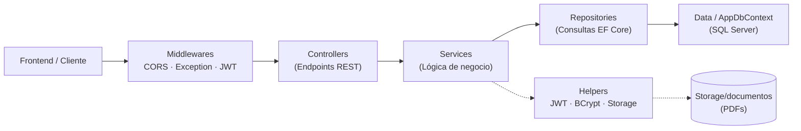

# Backend — SATC-ITS

API REST del **Sistema de Gestión Digital de Archivos (SATC-ITS)** desarrollada en **ASP.NET Core (.NET 10)**, **Entity Framework Core** y **SQL Server**.

---

## Stack tecnológico

- **Framework:** ASP.NET Core `.NET 10` (`net10.0`) + OpenAPI
- **Datos:** Entity Framework Core `10.0.13` + SQL Server / LocalDB
- **Seguridad:** JWT Bearer (`Microsoft.AspNetCore.Authentication.JwtBearer`) + `BCrypt.Net-Next`
- **Despliegue:** Docker + Docker Compose

---

## Arquitectura

El backend usa una **arquitectura en capas** desacoplada por interfaces. Todas las respuestas HTTP siguen el formato estándar `ApiResponse<T>` (`{ success, message, data }`) y la lógica de negocio comunica resultados mediante `ServiceResult<T>`.



---

## Estado actual

| Módulo | Estado | Resumen |
| :--- | :---: | :--- |
| **Auth** | ✅ | Login (correo o núm. empleado), emisión de JWT y perfil (`/me`). |
| **Usuarios** | ✅ | Listado, detalle, alta, catálogo de roles y cambio de estado (`Activo`/`Inactivo`). |
| **Digitalización** | ✅ | CRUD de documentos, carga/descarga de PDFs (máx. 20 MB, firma `%PDF-`) y alta automática de expedientes. |
| **Workflow** | ✅ | Registro de trámites, máquina de estados y aprobación con firma validada por contraseña del revisor. |
| **Expedientes** | 🟡 | Entidad y configuración EF listas (usadas por Digitalización y Workflow); falta su CRUD propio. |
| **Resto de módulos** | ⏳ | Estructura base creada (archivos vacíos): *Almacenamiento, Auditoría, Clasificación, Configuración, Disposición, Etiquetado, Préstamos y Vigencias*. |

---

## Carpetas y archivos

### Raíz de `Backend/`

| Archivo | Propósito |
| :--- | :--- |
| `Program.cs` | Punto de entrada: registra servicios, ejecuta `DbSeeder` y configura el pipeline HTTP. |
| `Backend.csproj` | Definición del proyecto `.NET 10` y paquetes NuGet. |
| `appsettings.json` | Configuración base (`SatcDb`, parámetros JWT, CORS y logs). |
| `appsettings.Development.example.json` | Plantilla local con `Jwt:Key` y credenciales del `SeedAdmin`. |
| `appsettings.Development.json` | Secretos locales de desarrollo (no se sube a Git). |
| `Backend.http` | Peticiones HTTP de prueba para Auth y Usuarios. |
| `Dockerfile` / `.dockerignore` | Imagen multi-stage (`sdk:10.0` → `aspnet:10.0`) expuesta en el puerto `8080`. |

### Carpetas principales

| Carpeta | Función | Archivos implementados |
| :--- | :--- | :--- |
| `Controllers/` | Exponen los endpoints REST y controlan roles. | `AuthController.cs`, `UsuariosController.cs`, `DigitalizacionController.cs`, `WorkflowController.cs` |
| `Services/` | Lógica de negocio e interfaces (`Interfaces/`). | `AuthService.cs`, `UsuarioService.cs`, `DocumentoService.cs`, `TramiteService.cs` |
| `Repositories/` | Acceso a datos con EF Core e interfaces (`Interfaces/`). | `UsuarioRepository.cs`, `DocumentoRepository.cs`, `TramiteRepository.cs` |
| `Data/` | `AppDbContext`, mapeos Fluent API (`Configurations/`) y carga inicial (`Seed/`). | `AppDbContext.cs`, `DbSeeder.cs` (roles base + admin), configuraciones de `Usuario`, `Rol`, `Documento`, `Expediente`, `Tramite` |
| `Models/` | Entidades (`Entities/`), contratos (`DTOs/`) y constantes (`Enums/`). | Entidades: `Usuario`, `Rol`, `Documento`, `Expediente`, `Tramite`<br>DTOs: `Common` (`ApiResponse`, `ServiceResult`), `Auth`, `Usuarios`, `Digitalizacion`, `Workflow`<br>Enums: `EstadoTramite.cs` |
| `Extensions/` | Registro ordenado de dependencias en DI. | `ServiceCollectionExtensions.cs` (`AddAplicacion`, `AddAutenticacionJwt`, `AddCorsFrontend`) |
| `Helpers/` | Utilidades transversales. | `JwtHelper.cs`, `PasswordHasher.cs`, `FileStorageHelper.cs`, `SqlExceptionHelper.cs` |
| `Mappings/` | Conversiones entidad → DTO. | `MappingProfile.cs` (`Usuario.ToDto()`) |
| `Middlewares/` | Interceptores del pipeline HTTP. | `ExceptionMiddleware.cs` (errores `500` en formato `ApiResponse`) |
| `Properties/` | Perfiles de ejecución local. | `launchSettings.json` (`http://localhost:5037`, `https://localhost:7052`) |
| `Storage/` | Almacenamiento físico de PDFs digitalizados. | `documentos/` |
| `Migrations/` y `Validators/` | Carpetas reservadas para uso futuro. | `.gitkeep` |

<details>
<summary>Ver archivos creados como plantilla (pendientes de implementar)</summary>

- **Controllers:** `AlmacenamientoController`, `AuditoriaController`, `ClasificacionController`, `ConfiguracionController`, `DisposicionController`, `EtiquetadoController`, `ExpedientesController`, `PrestamosController`, `VigenciasController`
- **Services / Repositories / Configurations / Entities / DTOs:** archivos correspondientes a `Auditoria`, `Caja` (Almacenamiento), `Clasificacion`, `Configuracion`, `Disposicion`, `Etiqueta`, `Expediente` (parcial), `Prestamo`, `Vigencia`, además de `GenericRepository`, `PagedResult`, `ActualizarUsuarioDto` y `AuditoriaMiddleware`.
- **Enums:** `DestinoFinal`, `EstadoGeneral`, `EstadoPrestamo`, `EstadoVigencia`.

</details>

---

## Endpoints disponibles

| Módulo | Endpoints |
| :--- | :--- |
| **Auth** (`/api/auth`) | `POST /login` *(público)* · `GET /me` *(autenticado)* |
| **Usuarios** (`/api/usuarios`) *(solo Administrador)* | `GET /` · `GET /{id}` · `POST /` · `GET /roles` · `PATCH /{id}/estado` |
| **Digitalización** (`/api/digitalizacion`) | `GET /` · `GET /{id}` · `POST /` · `PUT /{id}` · `DELETE /{id}` · `POST /{id}/archivo` · `GET /{id}/archivo` |
| **Workflow** (`/api/workflow`) | `GET /?estado=` · `GET /{id}` · `POST /` · `PATCH /{id}/estado` · `DELETE /{id}` |

---

## Ejecución rápida

**Local (LocalDB):**
```powershell
Copy-Item Backend/appsettings.Development.example.json Backend/appsettings.Development.json
sqlcmd -S "(localdb)\MSSQLLocalDB" -i BD\init.sql
dotnet run --project Backend
```

**Docker (desde la raíz del repositorio):**
```powershell
docker compose up --build
```
La API queda disponible en `http://localhost:5037`.
