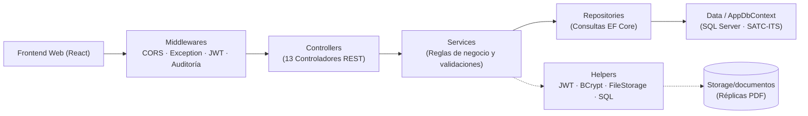

# Backend — SATC-ITS

API REST del **Sistema de Gestión Digital de Archivos para el Archivo de Concentración del Instituto Tecnológico de Saltillo (SATC-ITS)** desarrollada en **ASP.NET Core (.NET 10)**, **Entity Framework Core** y **SQL Server**.

---

## Stack tecnológico

- **Framework:** ASP.NET Core `.NET 10` (`net10.0`) + OpenAPI
- **Persistencia:** Entity Framework Core `10.0.13` + SQL Server 2022 / LocalDB (mapeo explícito con *Fluent API*)
- **Seguridad:** Autenticación JWT Bearer (`Microsoft.AspNetCore.Authentication.JwtBearer`), autorización basada en roles (`[Authorize(Roles = ...)]`) y hash de contraseñas con `BCrypt.Net-Next`
- **Almacenamiento documental:** Resguardo físico de réplicas digitales en formato PDF con validación binaria de firma (`%PDF-`), soporte de *range requests* y límite de 20 MB por archivo
- **Despliegue:** Docker multi-stage + Docker Compose

---

## Arquitectura

El backend implementa una **arquitectura en capas** desacoplada mediante interfaces e inyección de dependencias. Todas las respuestas HTTP siguen el contrato uniforme `ApiResponse<T>` (`{ success, message, data }`), mientras que las reglas de negocio comunican resultados y códigos de estado mediante `ServiceResult<T>`.



---

## Módulos implementados

| Módulo | Estado | Resumen funcional |
| :--- | :---: | :--- |
| **Auth** | ✅ | Inicio de sesión por correo institucional o número de empleado, emisión de token JWT y consulta de perfil activo (`/me`). |
| **Usuarios** | ✅ | CRUD completo de usuarios, catálogo de roles institucionales, activación/desactivación lógica y restablecimiento seguro de contraseñas. |
| **Clasificación (CGCA)** | ✅ | Gestión jerárquica recursiva del Cuadro General de Clasificación Archivística (*Fondo, Sección, Serie, Subserie*), plazos de conservación, destino final y validación anticiclos. |
| **Expedientes** | ✅ | Registro, consulta, actualización y baja controlada de expedientes vinculados a series documentales y cajas físicas con control de capacidad máxima. |
| **Etiquetado** | ✅ | Generación y trazabilidad de etiquetas de identificación (`ETQ-...`) asociadas a expedientes para emisión de marbetes con QR y código de barras. |
| **Préstamos (Trazabilidad)** | ✅ | Control de entradas y salidas mediante folios de pase de salida, registro de préstamos, prórrogas, devoluciones y seguimiento de solicitantes. |
| **Digitalización y Resguardo** | ✅ | CRUD de documentos, carga y descarga de réplicas digitales PDF (máx. 20 MB, verificación de firma `%PDF-`) y asociación automática con expedientes. |
| **Almacenamiento Sistematizado** | ✅ | Administración de cajas físicas, cálculo automático de ocupación por expediente y reubicación estructural por pasillo, estante y batería. |
| **Workflow (Control de Flujo)** | ✅ | Registro de trámites, máquina de estados (`Pendiente`, `En Revisión por Archivo`, `Aprobado`, `Rechazado`) y aprobación con firma electrónica validada contra credenciales del revisor. |
| **Vigencias Documentales** | ✅ | Control de plazos de conservación conforme al Catálogo de Disposición Documental (CADIDO), cálculo de semáforo (`Vigente`, `Próximo a vencer`, `Vencido`) y alertas de vencimiento. |
| **Auditoría (Cumplimiento)** | ✅ | Registro automático y consulta de bitácora de operaciones por usuario, acción, entidad afectada, fecha/hora e IP, conforme a la Ley General de Archivos y protección de datos. |
| **Disposición Documental** | ✅ | Gestión de bajas documentales y transferencias secundarias/históricas, generación foliada de Actas de Baja (`ACTA-BAJA-YYYY-XXXX`) y autorización directiva. |
| **Configuración** | ✅ | Administración persistente de parámetros generales e institucionales del Archivo de Concentración. |

---

## Roles y control de acceso (RBAC)

Al iniciar la aplicación, `DbSeeder` garantiza la existencia de los **5 roles institucionales** y crea el usuario administrador inicial si la base de datos está vacía:

| Rol | Alcance en los endpoints de la API |
| :--- | :--- |
| **Administrador** | Gestión exclusiva de usuarios, estructura del CGCA, parámetros de configuración, consulta de auditoría, trazabilidad y resguardo digital. |
| **Encargada de Archivo** | Operación integral del archivo: expedientes, etiquetado, cajas físicas, préstamos/devoluciones, digitalización, flujo de trámites, vigencias y actas de disposición. |
| **Trabajador RRHH** | Consulta de expedientes y réplicas digitales PDF, registro de digitalización y solicitud/seguimiento de préstamos documentales. |
| **Servicio Social** | Apoyo operativo controlado en captura de expedientes, generación de etiquetas, ubicación de cajas y digitalización de documentos PDF. |
| **Directivo** | Dictaminación de trámites con firma electrónica, supervisión de bitácoras de auditoría y autorización de transferencias o bajas documentales. |

---

## Estructura de carpetas y archivos

### Raíz de `Backend/`

| Archivo | Propósito |
| :--- | :--- |
| `Program.cs` | Punto de entrada: configura servicios, ejecuta `DbSeeder` y define el pipeline HTTP (CORS, manejo global de errores, auditoría, JWT y controladores). |
| `Backend.csproj` | Definición del proyecto `.NET 10` y dependencias NuGet (`EF Core SqlServer`, `JwtBearer`, `BCrypt.Net-Next`, `OpenApi`). |
| `appsettings.json` | Configuración base de cadena de conexión (`SatcDb`), parámetros `Jwt`, orígenes `Cors` y niveles de log. |
| `appsettings.Development.example.json` | Plantilla de configuración local con claves de ejemplo para `Jwt:Key` y `SeedAdmin`. |
| `Backend.http` | Colección de peticiones HTTP de prueba para verificación rápida de endpoints. |
| `Dockerfile` / `.dockerignore` | Construcción multi-stage (`sdk:10.0` → `aspnet:10.0`) expuesta en el puerto `8080`. |

### Capas internas

| Carpeta | Responsabilidad | Componentes incluidos |
| :--- | :--- | :--- |
| `Controllers/` | Exposición de endpoints REST, validación de entrada y políticas `[Authorize]`. | `AuthController`, `UsuariosController`, `ClasificacionController`, `ExpedientesController`, `EtiquetadoController`, `PrestamosController`, `DigitalizacionController`, `AlmacenamientoController`, `WorkflowController`, `VigenciasController`, `AuditoriaController`, `DisposicionController`, `ConfiguracionController` |
| `Services/` | Reglas de negocio, validaciones de dominio, control de transiciones y mapeos a DTO (`Interfaces/`). | `AuthService`, `UsuarioService`, `ClasificacionService`, `ExpedienteService`, `EtiquetaService`, `PrestamoService`, `DocumentoService`, `CajaService`, `TramiteService`, `VigenciaService`, `AuditoriaService`, `DisposicionService`, `ConfiguracionService` |
| `Repositories/` | Consultas asíncronas y persistencia con Entity Framework Core (`Interfaces/`). | `GenericRepository`, `UsuarioRepository`, `ClasificacionRepository`, `ExpedienteRepository`, `EtiquetaRepository`, `PrestamoRepository`, `DocumentoRepository`, `CajaRepository`, `TramiteRepository`, `VigenciaRepository`, `AuditoriaRepository`, `DisposicionRepository`, `ConfiguracionRepository` |
| `Data/` | `AppDbContext`, configuraciones Fluent API (`Configurations/`) y semilla inicial (`Seed/DbSeeder.cs`). | Configuraciones de `Usuario`, `Rol`, `Clasificacion`, `Expediente`, `Etiqueta`, `Prestamo`, `Documento`, `Caja`, `Tramite`, `Vigencia`, `Auditoria`, `Disposicion`, `Configuracion` |
| `Models/` | Entidades de dominio (`Entities/`), contratos de entrada/salida (`DTOs/`) y catálogos constantes (`Enums/`). | Entidades de las 13 tablas del sistema; DTOs agrupados por módulo + `Common` (`ApiResponse`, `ServiceResult`, `PagedResult`); Enums `DestinoFinal`, `EstadoGeneral`, `EstadoPrestamo`, `EstadoTramite`, `EstadoVigencia` |
| `Extensions/` | Registro modular de dependencias y seguridad en `IServiceCollection`. | `ServiceCollectionExtensions.cs` (`AddAplicacion`, `AddAutenticacionJwt`, `AddCorsFrontend`) |
| `Helpers/` | Utilidades transversales de seguridad, archivos y base de datos. | `JwtHelper.cs`, `PasswordHasher.cs`, `FileStorageHelper.cs`, `SqlExceptionHelper.cs` |
| `Mappings/` | Métodos de extensión para conversión de entidades a DTOs. | `MappingProfile.cs` |
| `Middlewares/` | Interceptores globales del pipeline HTTP. | `ExceptionMiddleware.cs` (respuestas `500` estandarizadas) y `AuditoriaMiddleware.cs` (trazabilidad de operaciones) |
| `Storage/` | Resguardo en disco o volumen Docker de los archivos PDF digitalizados. | `documentos/` |

---

## Endpoints disponibles

| Módulo | Ruta base | Operaciones REST |
| :--- | :--- | :--- |
| **Auth** | `/api/auth` | `POST /login` *(público)* · `GET /me` |
| **Usuarios** | `/api/usuarios` | `GET /` · `GET /{id}` · `POST /` · `PUT /{id}` · `DELETE /{id}` · `GET /roles` · `PATCH /{id}/estado` · `PATCH /{id}/password` |
| **Clasificación** | `/api/clasificaciones` | `GET /` · `POST /` · `PUT /{id}` · `DELETE /{id}` |
| **Expedientes** | `/api/expedientes` | `GET /` · `GET /{id}` · `POST /` · `PUT /{id}` · `DELETE /{id}` |
| **Etiquetado** | `/api/etiquetado` | `GET /etiquetas` · `POST /generar` |
| **Préstamos** | `/api/prestamos` | `GET /` · `GET /{id}` · `POST /` · `PUT /{id}` · `PATCH /{id}/devolucion` · `PATCH /{id}/prorroga` · `DELETE /{id}` |
| **Digitalización** | `/api/digitalizacion` | `GET /` · `GET /{id}` · `POST /` · `PUT /{id}` · `DELETE /{id}` · `POST /{id}/archivo` · `GET /{id}/archivo` |
| **Almacenamiento** | `/api/almacenamiento` | `GET /cajas` · `POST /cajas` · `PUT /cajas/{id}` · `PUT /cajas/{id}/ubicacion` · `DELETE /cajas/{id}` |
| **Workflow** | `/api/workflow` | `GET /?estado=` · `GET /{id}` · `POST /` · `PATCH /{id}/estado` · `DELETE /{id}` |
| **Vigencias** | `/api/vigencias` | `GET /` · `GET /alertas` · `POST /` · `PUT /{id}` · `POST /sincronizar-cadido` · `DELETE /{id}` |
| **Auditoría** | `/api/auditoria` | `GET /` · `POST /verificar-integridad` · `GET /exportar` |
| **Disposición** | `/api/disposicion` | `GET /` · `POST /` · `POST /acta-baja` · `POST /autorizar-transferencia` |
| **Configuración** | `/api/configuracion` | `GET /` · `PUT /` |

---

## Ejecución

### Desarrollo local (SQL Server LocalDB)

```powershell
# 1. Crear archivo local de configuración a partir de la plantilla
Copy-Item Backend/appsettings.Development.example.json Backend/appsettings.Development.json

# 2. Inicializar la base de datos SATC-ITS con el esquema completo
sqlcmd -S "(localdb)\MSSQLLocalDB" -i BD\init.sql

# 3. Compilar y levantar el servidor API
dotnet run --project Backend
```

### Despliegue con Docker Compose (desde la raíz del repositorio)

```powershell
# Configurar variables en .env (SA_PASSWORD, JWT_KEY, ADMIN_PASSWORD) y levantar contenedores
docker compose up --build -d
```

La API quedará disponible en `http://localhost:5037` (con especificación OpenAPI habilitada en entorno `Development`).
